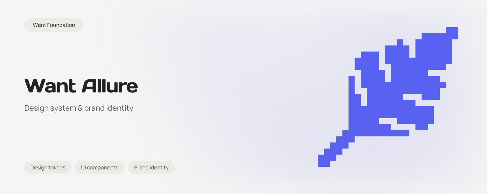

# Want Allure

<picture>
  <source media="(prefers-color-scheme: dark)" srcset="assets/brand/readme/banner-dark.svg">
  
</picture>

Shared design foundations and UI kits for Want products across web and mobile.

## Packages

- @want-foundation/allure: JSON tokens, compiled CSS, local fonts, brand assets and opt-in browser effects.
- @want-foundation/allure-react: React 19 primitives and generic product compositions built on Radix.
- want_allure: Flutter themes, controls, compositions and motion built on ForUI, for Android, iOS, web, macOS, Windows and Linux.

All public packages use version 1.2.0. Keep matching releases aligned. The Flutter adapter is published as `want_allure` on pub.dev and uses ForUI with the same Want tokens and component families.

Upgrading from the previous package names? Follow the [1.0.0 migration guide](docs/migration-1.0.0.md).

## Install a release

For a published release, install the matching versions:

```sh
npm install @want-foundation/allure@1.2.0 @want-foundation/allure-react@1.2.0 react@^19 react-dom@^19
```

Import the stylesheet once in the application's entry point. The font stylesheet is optional and serves its font files locally.

```tsx
import '@want-foundation/allure/styles.css';
import '@want-foundation/allure/fonts.css';
import { Button, Field, FieldLabel, Input } from '@want-foundation/allure-react';

export function Example() {
  return <Field>
    <FieldLabel htmlFor="name">Name</FieldLabel>
    <Input id="name" autoComplete="name" />
    <Button type="button">Continue</Button>
  </Field>;
}
```

No stylesheet copying, source aliases or scanning library sources with Tailwind is required. Consumers may bring their own layout styles through className and override semantic variables intentionally. React and React DOM are peers and are not bundled. A consumer that also uses Tailwind 4 can import @want-foundation/allure/tailwind.css after Tailwind to register the same semantic utilities for its own source files. This integration is optional; library components already have compiled CSS.

## Flutter

```sh
flutter pub add want_allure:^1.2.0
```

Import `package:want_allure/want_allure.dart` and wrap the application content with `WantTheme`. The package includes local fonts, its SVG asset and all 44 web component families. See [Flutter documentation](packages/flutter/README.md) and [component parity](docs/flutter-parity.md).

From this checkout, use FVM with Flutter 3.47.7 and Dart 3.13.5:

```sh
fvm install
fvm flutter pub get --directory packages/flutter
bun run flutter:check
bun run flutter:test
bun run flutter:consumer
bun run flutter:example
```

The example supports six platforms and demonstrates themes, RTL, accessibility settings and controlled state. Build and device evidence remain separate.

## Want design skill

The reusable skill in [skills/want-design/SKILL.md](skills/want-design/SKILL.md) covers Want brand rules, typography, composition, UI/UX, motion, and a calm, concrete product voice. It includes React and Flutter integration guidance and English/Russian UI-copy examples. Product-specific instructions and approved themes take precedence over shared defaults.

Inside this repository, build once and use the root script for a personal installation:

```sh
bun run build
bun run skill:install --global
```

Use `bun run skill:install` for this checkout, or add `--dest /path/to/project/.agents/skills` to select another project. The script supports the same installer options. In this Bun workspace, npm can select the local foundation package without a root bin link, causing `npx` to report `want-design-install: command not found`.

From a consumer project's root, install the published skill with Node.js and npm:

```sh
npx --yes --package=@want-foundation/allure@1.2.0 want-design-install
```

This creates `.agents/skills/want-design` in the current directory. The published skill includes its references and a token snapshot, so it does not need this repository afterward.

For a personal installation shared across projects:

```sh
npx --yes --package=@want-foundation/allure@1.2.0 want-design-install --global
```

This uses `~/.agents/skills/want-design`. Use `--dest PATH` instead of `--global` to select another parent skills directory; `want-design` is appended to that path. Quote paths containing spaces. `--help` lists the options. The installer does not change project configuration or install UI dependencies.

Invoke `$want-design` when working on a Want interface. Discovery also uses the skill's Want-specific description. If the current session has already loaded its skill catalog, start a new session after installation.

Matching installations are unchanged, including extra local files. Different installations and symlink destinations are never overwritten. To update, move the existing `want-design` directory to a backup outside the skills directory, run the version-pinned command again, and review any local changes before removing that backup.

## Upgrade

Upgrade foundation and React together to the same released version. Read the changelog and any migration notes, update both dependencies, then run the consumer application's checks. Keep product wrappers and service calls in the consumer.

## Public contracts

Foundation exports its tokens as JSON at @want-foundation/allure/tokens.json and as the tokens JavaScript export. The assets export includes @want-foundation/allure/assets/wallpapers.svg. Importing the JavaScript entry is safe during SSR.

React exports the existing accordion, alert, badge, breadcrumb, button, card, dialog, field, input, label, navigation menu, radio group, select, separator, sheet, skeleton, switch, tabs and textarea families. Their public variants and native element props remain available.

Shared compositions are BrandLogo, BrandLockup, MediaCard, ContactCard, ThemeToggle and CommentFeed. Each exports its props type. Supply product names, images, labels, URLs, prepared comment authors and dates, and action callbacks. CommentFeed does not fetch, reorder or limit records. Optional createdAt contains a machine-readable dateTime and a consumer-prepared label, so SSR and hydration use the same text. ThemeToggle is controlled through theme and onThemeChange; consumers own saved preferences, system-theme subscriptions and telemetry.

DateField accepts a local date (YYYY-MM-DD) or local date and time (YYYY-MM-DDTHH:mm) without changing its wall time. Pass mode, value, onChange, locale and every label in DateFieldLabels. The optional today value lets the consumer supply the current time in its chosen time zone. onCommit fires when a changed value is selected or the calendar closes. The consumer owns storage and conversion to server timestamps. UrlField accepts a controlled URL string and an accessible openLabel. OpenUrl renders a new-tab link only for HTTP(S) URLs. Window renders a page section with a named heading, optional kicker and actions, and consumer content.

Additional controls are Checkbox, DropdownMenu, Toast, Tooltip, Combobox, Popover, Table, Pagination, FileUpload and Progress. Their composition parts and controlled APIs are described in packages/react/README.md.

Set data-theme="light" or data-theme="dark" on the document root for explicit selection. Also toggle the dark class for class-based Tailwind states. Without an explicit choice, the stylesheet follows the system color preference.

## Optional effects

```ts
import { initInteractionEffects, burstConfetti, initBackgroundMotion } from '@want-foundation/allure';

const disposeInteractions = initInteractionEffects();
const disposeBackground = initBackgroundMotion({ background, control, shimmerDelayMs: [5000, 10000] });
background.dispatchEvent(new Event('want:background-shimmer'));
const disposeConfetti = burstConfetti(clickedElement);

// Dispose when the owning page unmounts.
disposeInteractions();
disposeBackground();
disposeConfetti();
```

The background container uses the page-background class with one child element. The control supplies data-pause-label and data-play-label. Mount it outside the content flow inside a positioned, clipped page wrapper. The default storage key is want-background-motion; storageKey may override it. Keep this decoration outside administration and reading surfaces.

The optional shimmerDelayMs pair sets the minimum and maximum pause between waves in milliseconds; the default remains [8000, 18000]. Delays must be finite, ordered and within 0 to 2147483647 ms. Dispatch want:background-shimmer on the background container to start or restart its four-second wave. Requests while paused, hidden, reduced-motion or forced-colors are ignored. Restarting a wave preserves the sphere and gradient phases. The consumer owns click targets and hit testing. Cleanup removes the event listener and pending timers.

Effects do not subscribe to application download events or start downloads. Call confetti beside the native download action. Reduced motion, unsuitable pointers and forced colors disable decorative interaction effects.

## Unified web application

The Astro application includes an English landing page at `/` and a Russian version at `/ru/`. React catalogues live at `/react/` and `/ru/react/`; Flutter catalogues at `/flutter/` and `/ru/flutter/`. Navigation shares the selected theme and language. Flutter initializes only on its catalogue route.

Use Bun 1.3.14 and the pinned FVM SDK:

```sh
bun install --frozen-lockfile
bun run dev
```

This prepares the package assets and Flutter runtime, then starts Astro on http://localhost:4321. Astro and React changes reload during development. After editing Flutter, run `bun run web:flutter` to rebuild its embedded runtime. `bun run flutter:example` still runs the standalone example on a selected device.

Build and preview the complete static application:

```sh
bun run web:build
bun run web:preview --port 4321
```

The artifact is `apps/showcase/dist`, including `/_flutter/`. Generated runtime files are ignored by Git. `bun run build` continues to build only the public npm packages. The default canonical origin is `https://allure.want.foundation`; `SITE_URL` may override it at build time. Production hosting is tracked in [issue #20](https://github.com/andrey-krasheninnikov/want-allure/issues/20).

## Brand resources

The source artwork lives in `assets/brand`. Logo variants, backgrounds, favicon, social images and README banners preserve the supplied geometry and colors. The source set includes its original usage notes and font licenses. The ZIP duplicate is not stored.

Run `bun run assets:sync` after changing the source artwork. `bun run assets:check` verifies the package and Flutter web copies. Runtime logos and backgrounds are distributed under `@want-foundation/allure/assets/allure/` and Flutter's `assets/brand/allure/`. The existing Wallpapers asset remains available. Product applications choose their own approved identity.

## Develop and verify

```sh
bun run check
bun test tests
bun run flutter:check
bun run flutter:test
bun run web:build
bun run test:ui
bun run test:consumer
bun run flutter:consumer
```

Checks run locally. Browser checks use the combined production artifact and cover both landing locales, navigation, themes, Flutter initialization and existing React controls. Reports and screenshots stay outside the source tree. Consumer checks install separate distributions and remove their temporary projects afterward. Production, physical-device and local test evidence remain distinct.

## Release

Build and verify the final candidate before publishing. Inspect both tarballs, keep only distribution files and license notices, and publish foundation before React with public access. Use the repository release tag v1.2.0 for this release. Never overwrite a published version; reconcile a registry response before retrying a timed-out publish.

The npm organization is want-foundation. Publishing requires a signed-in owner with the required npm authentication. Credentials never belong in source files. Registry availability is confirmed as part of release, separately from the source merge.

## Boundaries and licensing

Read AGENTS.md, DESIGN.md, GLOSSARY.md and docs/adr. Repository workflow configuration lives in docs/agents and can be edited directly.

The initial source is Want Wallpapers main at 27370a2b8228b54e0c1b9432f01373bc8bf000ef. The catalogue, backend, application routes, analytics and advertising stay there. Consumer adoption is tracked separately in https://github.com/andrey-krasheninnikov/want-wallpapers/issues/174.

MIT applies to this repository's code. Preserve the included font licenses and third-party notices. Brand resources retain their existing notices.
