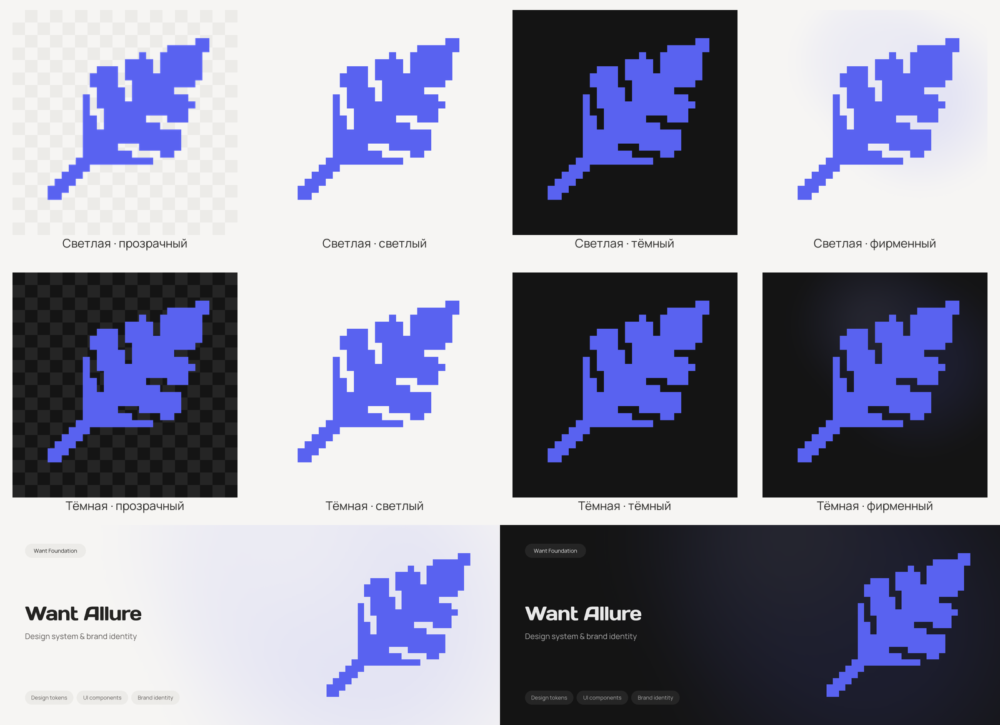
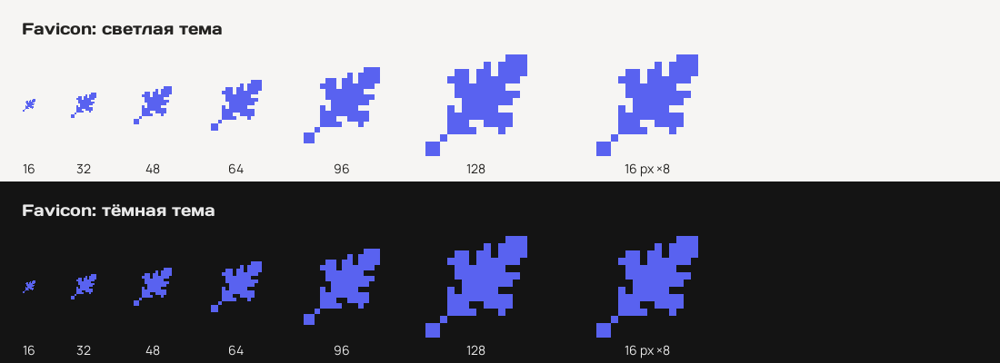

# Want Allure

Пиксельное перо с диагональным стержнем и повторяющимися сегментами. Цвет знака `#5962F0` сохранён во всех темах. Фирменный фон использует нейтральные поверхности Want и мягкую фиолетовую сферу. Баннеры используют Days One и Manrope 400.



[HTML-превью](banners.html) работает локально без сети. В нём доступны логотипы, баннеры и favicon.

## Основные файлы

| Вариант | SVG | PNG 2048×2048 |
| --- | --- | --- |
| Светлый фирменный фон | [Вектор](want-allure-brand-light.svg) | [Растр](want-allure-brand-light.png) |
| Тёмный фирменный фон | [Вектор](want-allure-brand-dark.svg) | [Растр](want-allure-brand-dark.png) |

Исходные [SVG](want-allure-feather.svg) и [PNG](want-allure-feather.png) с белым фоном сохранены отдельно. Полный знак в остальных вариантах сохраняет геометрию исходного SVG. Просветы между сегментами пера вырезаны из знака: в прозрачных версиях они имеют настоящую прозрачность.

## Темы и фоны

В `logos/light/` и `logos/dark/` находятся четыре варианта в SVG и PNG 2048×2048:

| Имя | Фон |
| --- | --- |
| `transparent` | Прозрачный |
| `light` | Светлый `#F6F5F3` |
| `dark` | Тёмный `#141414` |
| `brand` | Фирменная сфера на фоне выбранной темы |

Цвет знака одинаков в обеих темах. Варианты с явно заданными прозрачным, светлым и тёмным фонами совпадают между темами; фирменный фон зависит от темы.

Фирменные фоны без знака: [светлый SVG](backgrounds/brand-light.svg), [светлый PNG](backgrounds/brand-light.png), [тёмный SVG](backgrounds/brand-dark.svg), [тёмный PNG](backgrounds/brand-dark.png).

## Telegram

В `telegram/light/` и `telegram/dark/` находятся все четыре фона:

- `avatar-{фон}-1024.svg`: векторный мастер.
- `avatar-{фон}-1024.png`, `-512.png`, `-256.png`: квадратные экспорты.
- `avatar-brand-1024.jpg`: фирменный аватар в JPEG.
- `avatar-brand-circle-preview.svg` и `.png`: предварительный просмотр круглой обрезки.

Знак расположен с запасом под круглую обрезку. Для загрузки аватара используйте непрозрачный PNG или JPEG. Прозрачные версии предназначены для компоновки.

Основные аватары: [светлый PNG 1024](telegram/light/avatar-brand-1024.png), [тёмный PNG 1024](telegram/dark/avatar-brand-1024.png).

Баннеры для описания или приветственного сообщения, 640×360: [светлый PNG](telegram/description-light.png), [тёмный PNG](telegram/description-dark.png), [светлый SVG](telegram/description-light.svg), [тёмный SVG](telegram/description-dark.svg).

## GitHub

В `github/light/` и `github/dark/` находятся аватары со всеми четырьмя фонами: SVG 512×512 и PNG 256×256, 512×512.

Социальные карточки 1280×640: [светлый PNG](github/social-preview-light.png), [тёмный PNG](github/social-preview-dark.png), [светлый SVG](github/social-preview-light.svg), [тёмный SVG](github/social-preview-dark.svg). Каждый PNG меньше 1 MB.

## Баннер README

В `readme/` находятся светлая и тёмная версии 1600×640 в SVG и PNG:

- [Светлый SVG](readme/banner-light.svg), [светлый PNG](readme/banner-light.png).
- [Тёмный SVG](readme/banner-dark.svg), [тёмный PNG](readme/banner-dark.png).

Для README, рядом с которым расположен каталог `assets`:

```html
<picture>
  <source media="(prefers-color-scheme: dark)" srcset="assets/readme/banner-dark.svg">
  <source media="(prefers-color-scheme: light)" srcset="assets/readme/banner-light.svg">
  
</picture>
```

Надписи в SVG переведены в контуры; устанавливать шрифты не требуется. HTML-превью содержит встроенные шрифты. Их лицензии находятся в `font-licenses/`.

## Favicon

Для favicon подготовлена микроверсия пера на сетке 16 px. Сохранены наклон силуэта и ступенчатая геометрия, мелкие просветы упрощены. Полный знак используется во всех остальных наборах.



В `favicon/light/` и `favicon/dark/`:

- PNG: 16, 32, 48, 64, 96, 128, 180, 192, 256 и 512 px.
- `favicon-512.svg`: векторная микроверсия.
- `favicon.ico`: размеры 16, 32, 48, 64 и 256 px внутри одного файла.
- `apple-touch-icon.png`: 180×180 на непрозрачном фоне.
- `maskable-512.svg` и `.png`: знак с дополнительными полями под системную маску.
- `site.webmanifest`: ссылки на иконки 192, 512 и maskable 512 px.

В корне `favicon/` находятся адаптивный `favicon.svg`, стандартный светлый `favicon.ico` и монохромный `safari-pinned-tab.svg`. Адаптивный SVG выбирает фон по `prefers-color-scheme`.

После копирования `favicon/` в публичный каталог сайта:

```html
<link rel="icon" href="/favicon/favicon.ico" sizes="16x16 32x32 48x48 64x64 256x256">
<link rel="icon" href="/favicon/favicon.svg" type="image/svg+xml" sizes="any">
<link rel="apple-touch-icon" href="/favicon/light/apple-touch-icon.png" sizes="180x180">
<link rel="mask-icon" href="/favicon/safari-pinned-tab.svg" color="#5962F0">
<link rel="manifest" href="/favicon/light/site.webmanifest">
```

Пути в манифесте относительны его каталогу. При подключении к приложению выберите тему и добавьте нужные параметры запуска приложения.

## Использование

Для загрузки в сервисы используйте PNG или JPEG. Для вёрстки и масштабирования используйте SVG. Сохраняйте пропорции знака и поля аватаров. Фон статичен.

SVG содержат векторные контуры и градиенты без внешних изображений, шрифтов и скриптов. Набор не меняет исходный код приложения и не подключает графику к сервисам автоматически.
